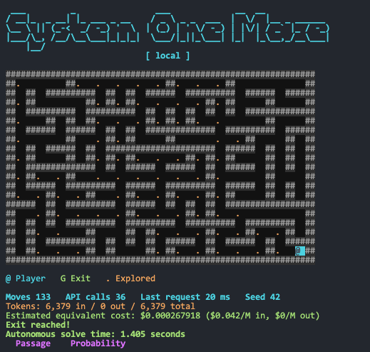

## System One Decision Models Playground

A collection of standalone Python examples for exploring **System One models**,
also known as **decision models**. These models return structured decisions that
software can act on, such as a category, a yes/no probability, or a score on an
ordered scale, rather than a free-form text response.

The examples cover Microsoft Decision-1 in Microsoft Foundry, Jev by TypeSafeAI,
the OpenAI Decisions API, and a local decision model through Ollama. A separate
example uses a general-purpose LLM to illustrate how structured-output estimates
differ from native decision-model responses.

All code in this repository is free to use, modify, and share for personal or
commercial purposes. It is provided as-is, without warranty. Third-party
libraries, models, and services remain subject to their own licenses and terms.

## New to System One / Decision Models?

If you are not familiar with System One models, start with
[this introduction](https://arafattehsin.com/blog/introduction-to-decision-models/)
before exploring the examples below.

## Examples

| Script | Purpose |
| --- | --- |
| [01_decision1.py](01_decision1.py) | Classify support requests with Decision-1 over REST; report example accuracy and latency. |
| [02_decision1_combined.py](02_decision1_combined.py) | Ask Decision-1 choice, score, and yes/no (`noul`) questions in a single REST request. |
| [03_llm.py](03_llm.py) | Use an Azure-hosted LLM through MAF to produce structured estimates for the same decision tasks. |
| [04_maf_decision1.py](04_maf_decision1.py) | Call native Decision-1 questions through Microsoft Agent Framework. |
| [05_maf_jev.py](05_maf_jev.py) | Call native Jev questions through Microsoft Agent Framework. |
| [06_openai_decision_api.py](06_openai_decision_api.py) | Call the native OpenAI Decisions API using the OpenAI Python SDK. |
| [07_ollama_laya.py](07_ollama_laya.py) | Call a local native decision model through Ollama and the MAF TypeSafe extension. |
| [08_maze.py](08_maze.py) | Explore a terminal maze with model-guided decisions, locally or through remote Decision-1. |

Examples 04 and 05 use the [alpha TypeSafe extension](https://learn.microsoft.com/en-us/agent-framework/integrations/by-provider/type-safe-ai) for Microsoft Agent
Framework, provided by `agent-framework-typesafe`, to access both Jev and
Decision-1. Example 07 uses the same extension for local decisions. The extension
is prerelease software, so its APIs and compatibility requirements may change.

The probabilities and confidence values in example 03 are subjective LLM
estimates, not calibrated native decision probabilities. These scripts are
learning examples, not a controlled benchmark across providers.

## Prerequisites

To run the full collection, you need:

* Python 3.13 or newer and [uv](https://docs.astral.sh/uv/getting-started/installation/)
* An Azure subscription and a Microsoft Foundry project with a deployed Microsoft Decision-1 model
* [Azure CLI](https://learn.microsoft.com/en-us/cli/azure/install-azure-cli) for the Azure examples' local sign-in workflow
* A [TypeSafeAI account](https://typesafe.ai/) with Jev API access and an API key
* An [OpenAI account](https://platform.openai.com/) with access to the [Decisions API](https://developers.openai.com/api/docs/guides/decisions?) and a compatible model
* [Ollama](https://ollama.com/) with a native decision-capable model, such as [Laya](https://ollama.com/library/laya), for the local examples

You only need the services used by the examples you choose to run. Example 03
also requires a separate Azure-hosted LLM deployment that supports structured
output. A standard chat-only Ollama model cannot replace a native decision model.
Hosted API calls may incur charges.

### Deploy Decision-1 in Microsoft Foundry

Before running examples 01, 02, or 04, or the maze with `-d`, deploy
**Microsoft-Decision-1** from the Microsoft Foundry model catalog into your
Foundry resource. Record the native decision endpoint and your deployment name.

Use these references for the model overview, deployment walkthrough, and request
format:

* [Not Every Decision Needs an LLM: Getting Started with Microsoft-Decision-1](https://techcommunity.microsoft.com/blog/educatordeveloperblog/not-every-decision-needs-an-llm-getting-started-with-microsoft-decision-1/4563468)
* [Introducing Microsoft-Decision-1, our model for fast decision-making](https://commandline.microsoft.com/microsoft-decision-1-model-foundry/)

The Azure examples use Microsoft Entra authentication. Before running examples
01 through 04 or the maze with `-d`, sign in with an identity permitted to invoke
your deployment:

```bash
az login
```

Examples 01 through 04 use `DefaultAzureCredential`, which can use that CLI
session or another supported credential source. The maze's remote mode explicitly
uses `AzureCliCredential` and requires Azure CLI sign-in. Local Ollama and
API-key-based examples do not require Azure CLI or `az login`.

## Setup

From the repository directory, install the dependencies and create your local
configuration file:

```bash
uv sync
cp .env.sample .env
```

`uv sync` creates the virtual environment and installs the dependencies declared
in [pyproject.toml](pyproject.toml), including the alpha MAF TypeSafe extension.
The scripts run directly with `uv run`; no package installation step or manual
environment activation is needed.

Edit your local environment file using [.env.sample](.env.sample) as the guide.
Replace the example endpoints and model names with values available to your
accounts, and supply API keys where required.

| Service | Environment variables |
| --- | --- |
| Azure Decision-1 | `AZURE_ENDPOINT`, `DEPLOYMENT_NAME` |
| Azure LLM comparison | `GPT_AZUREENDPOINT`, `GPT_DEPLOYMENT_NAME` |
| TypeSafeAI Jev | `JEV_ENDPOINT`, `JEV_DEPLOYMENT_NAME`, `JEV_KEY` |
| OpenAI Decisions | `OPENAI_ENDPOINT`, `OPENAI_DEPLOYMENT_NAME`, `OPENAI_KEY` |
| Local Ollama | `OLLAMA_ENDPOINT`, `OLLAMA_DEPLOYMENT_NAME` |

For Decision-1, use the native endpoint ending in
`/providers/microsoft/v1/systemone`, not a chat-completions endpoint. The local
Ollama example uses `http://localhost:11434/v1/systemone`. Ensure Ollama is running
and the configured decision model is available before making local requests.

## Run an Example

Start with the REST classification example, then try the combined questions or
MAF integration:

```bash
uv run 01_decision1.py
uv run 02_decision1_combined.py
uv run 04_maf_decision1.py
```

Run any other script from the examples table in the same way after configuring
its provider. Most examples print JSON responses and request latency; native
responses expose probabilities, confidence, and token usage where supported.

## Model-Guided Maze

Script [08_maze.py](08_maze.py) demonstrates a terminal maze game where a model
chooses which unexplored branch to take. Decisions come from a local model via
Ollama by default, or from remote Decision-1 when you pass **`-d`** (also available
as `--decision1`). Legal moves, forced passages, and dead-end backtracking are
handled locally; the model is called only when there is a choice of branches.



Run the local version:

```bash
uv run 08_maze.py
```

Switch to your Foundry Decision-1 deployment:

```bash
uv run 08_maze.py -d
```

Use `w`, `a`, `s`, and `d` to move manually, Enter for one AI exploration step,
`p` for AI autoplay, and `q` to quit. For unattended exploration with a repeatable
maze layout, use `--auto --seed 42`, with `-d` for remote decisions:

```bash
uv run 08_maze.py --auto --seed 42
uv run 08_maze.py -d --auto --seed 42
```

The display includes moves, model calls, token usage, decision latency, native
probabilities, and an estimated equivalent cost. Autoplay also reports total
solve time. The cost is an estimate, not a billing measurement or the cost of
running your local hardware.

## Example Run Results

The following results come from the supplied example runs. **API latency** is the
client-observed elapsed time, not server-side inference time. Script 01 reports
the median of five classification requests; scripts 02 through 07 each report
one call answering three questions.

Local Ollama tests ran on a MacBook Pro with an Apple M4 chip. Model identifiers
are shown as returned by each API. All models hosted in Microsoft Foundry and
used for the test results below were deployed in the **Sweden Central** region.
Warm-up/cache state and the exact model build behind `laya:latest` are not specified.

| Script | Model | Interface | API latency (ms) | Input tokens | Output tokens |
| --- | --- | --- | ---: | ---: | ---: |
| [01_decision1.py](01_decision1.py) | microsoft-decision-1 | REST | **305.8** (median, 5 calls) | 87-92 per call | 1 per call |
| [02_decision1_combined.py](02_decision1_combined.py) | microsoft-decision-1 | REST | **347.9** | 117 | 3 |
| [03_llm.py](03_llm.py) | gpt-6.1-sol | MAF, structured LLM output | **4,634.9** | 496 | 132 |
| [04_maf_decision1.py](04_maf_decision1.py) | microsoft-decision-1 | MAF, native decisions | **329.8** | 140 | 3 |
| [05_maf_jev.py](05_maf_jev.py) | jev-1.13.0 | MAF, native decisions | **306.7** | 456 | 69 |
| [06_openai_decision_api.py](06_openai_decision_api.py) | gpt-6-luna | OpenAI Decisions SDK | **303.6** | 417 | 0 |
| [07_ollama_laya.py](07_ollama_laya.py) | laya:latest | Local Ollama through MAF | **90.8** | 279 | 0 |

Local Laya had the lowest observed latency. Hosted native combined-decision
calls took 303.6 to 347.9 ms, compared with 4,634.9 ms for the general-purpose
LLM. The LLM also returned more output tokens than any native decision example
in these runs. Zero output tokens is valid for the native APIs that reported it;
it does not mean that no decisions were returned.

Deployment location matters when API calls take only a few hundred milliseconds.
For comparison, in separate runs the same decision models deployed in **West-3** responded in
approximately **700 ms**, compared with approximately **300 ms** in Sweden
Central, more than twice the client-observed latency. This observation reflects
the tested client and deployment locations, not an inherent regional performance
ranking; network round trips contribute to the measured time.

> [!NOTE]
> These runs are not a controlled benchmark or provider ranking. REST timers
> wrap `requests.post`; SDK timers also include client or framework processing.
> Workloads and network paths differ, and local Ollama avoids a remote service
> round trip. Repeated-run variability was not measured, so the timings do not
> establish a performance advantage for one provider or interface.

### Decision Results

All six combined-question runs selected **engineering**, but their severity and
repeat-contact estimates differed. Scores below use the scale 0 = Cosmetic,
1 = Minor, 2 = Major, 3 = Critical. Values are rounded for readability; scores
are the reported values, not recalculated from rounded probabilities.

| Example | P(engineering) | Severity score | Most likely severity | P(Critical) | P(repeat contact) |
| --- | ---: | ---: | --- | ---: | ---: |
| 02, Decision-1 REST | 99.26% | 2.204 | Major | 21.96% | 99.48% |
| 03, general-purpose LLM | 98.00% | 2.659 | Critical | 68.00% | 100.00% |
| 04, Decision-1 MAF | 99.72% | 2.428 | Major | 43.52% | 99.68% |
| 05, Jev | 100.00% | 2.810 | Critical | 82.00% | 98.00% |
| 06, OpenAI Decisions | 100.00% | 2.290 | Major | 35.00% | 100.00% |
| 07, local Laya | 77.85% | 2.140 | Major | 31.95% | 65.27% |

Jev and the general-purpose LLM favored Critical severity; both Decision-1 runs,
OpenAI Decisions, and Laya favored Major. Laya assigned less probability to
engineering and repeat contact than the hosted runs. A shared team choice
therefore does not imply agreement on the full decision or its uncertainty.

Script 01 correctly classified all five labeled requests, giving **100% accuracy
on those five examples**, with HTTP latencies ranging from 287.1 to 367.9 ms.
The five calls used 445 input tokens and 5 output tokens in total.

Five labeled examples do not establish general accuracy, and no reference
answers were supplied for the combined questions. More decimal places or higher
confidence do not prove better predictions; probability and confidence values
are not established as calibrated or comparable across providers. The LLM's
values are subjective generated estimates. Comparing accuracy, calibration,
and repeatability requires a labeled evaluation set and repeated measurements.